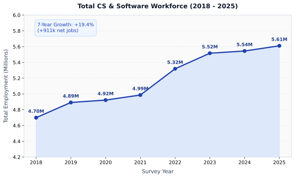
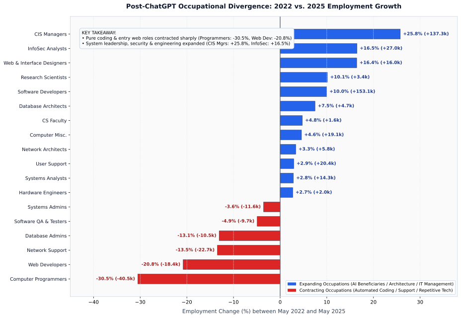
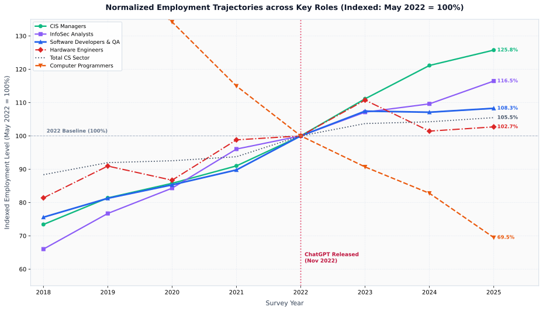
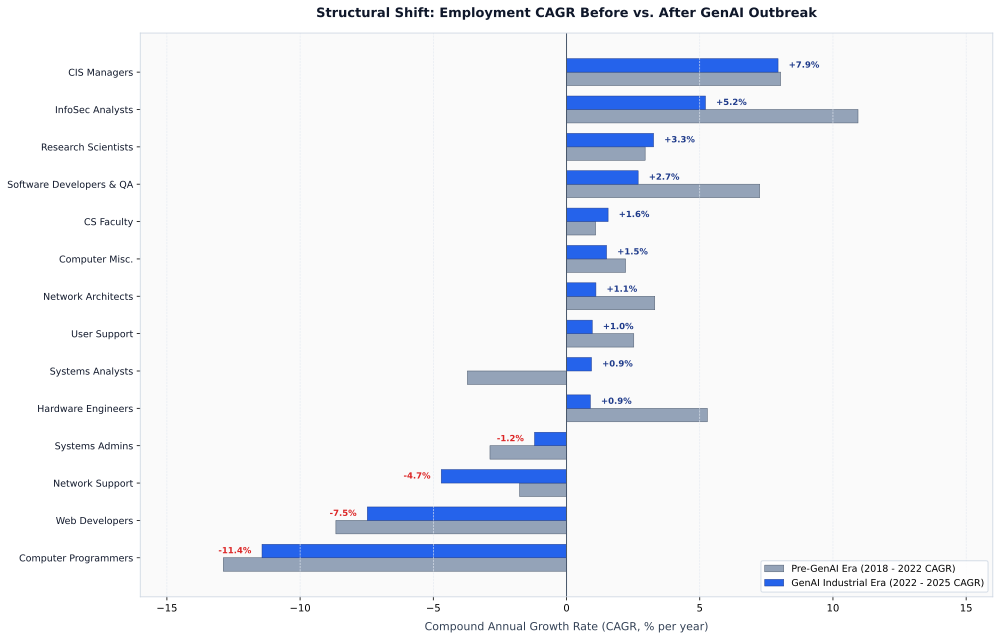
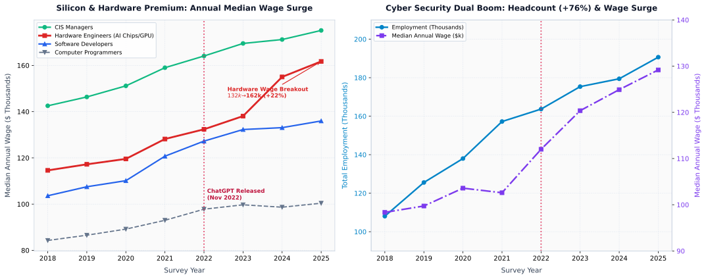
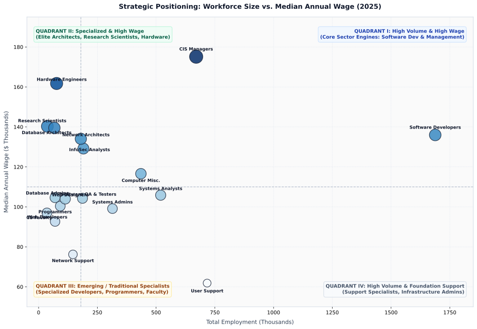

自从 2022 年底 OpenAI 发布 ChatGPT 以来，“AI 即将取代程序员”的讨论便持续引发广泛关注。从科技企业的局部结构性裁员，到“一人团队借助 AI 完成全流程开发”的技术演示，关于软件开发行业命运的焦虑在各类技术社区中屡见不鲜。

然而，**程序员真的正在被大模型广泛替代吗？被很多人视为“高阶技术人才”的软件开发工程师（Software Developers）到底遭受了多大程度的冲击？**

脱离宏观统计数据的个案与舆论报道，容易受到短期情绪与样本偏差的影响。为了客观观察行业全貌，我们提取并清洗了**美国劳工统计局（BLS）2018 年至 2025 年发布的国家级职业就业与薪资追踪数据（OEWS）**。

以 **2022 年 5 月**（ChatGPT 发布前夕的调查基准）作为前 AI 时代的分水岭，对比 **2025 年 5 月**（生成式 AI 进入工业化普及期）的实证数据，结合劳动经济学中**“雇佣规模（Quantity）”与“薪资回报（Price）”双维度模型**，我们可以摘下非理性的舆论滤镜，厘清这场技术变革在真实劳动力市场中的影响。

---

## 一、 大分化：岗位演进的结构性重塑

从官方宏观统计数据来看：**全美计算机与软件工程大类的总就业人数并未发生规模性下跌，反而从 2022 年的 531.9 万稳步扩张至 2025 年的 561.0 万（7 年累计净增 91.1 万人，后 AI 周期净增近 30 万人）。**

*图 1：2018–2025 年美国计算机与软件行业总体就业规模演进（单位：百万人）*

然而，在大盘规模保持稳健增长的总体趋势之下，行业内部正在发生清晰而深刻的**结构性分化**：

*图 2：2022 年 5 月至 2025 年 5 月各细分职业就业人数增减百分比与净差额*

观察上图的两端，可以分辨出两类截然不同的发展趋势：

### 1. 持续收缩阵营：标准化与常规编码

* **计算机程序员（Computer Programmers）**：就业人数缩减 **-30.5%**，3 年内净减少 **40,510 个岗位**，在所有 18 个细分职业中降幅最为明显。
* **网页开发者（Web Developers）**：缩减 **-20.8%**（净减少 18,430 人）。
* **基础运维与支持（Network Support / Database Admins）**：分别缩减 **-13.5%** 与 **-13.1%**。
* **软件测试（Software QA & Testers）**：就业人数亦出现微幅负增长（**-4.9%**）。

### 2. 逆势扩张阵营：战略管理、架构与安全

* **计算机与信息系统经理（CIS Managers）**：增长 **+25.8%**，净增 **137,350 个岗位**，成为全行业规模扩充的主要驱动力。
* **信息安全分析师（InfoSec Analysts）**：增长 **+16.5%**（净增 26,960 人）。
* **软件开发工程师（Software Developers）**：净增 **153,100 个岗位（+10.0%）**。

> **核心观察**：生成式 AI 并没有压缩整个软件产业的总体规模，但它在加速替代那些**从事标准化、低复杂度代码编写的基础开发岗位**；与此同时，负责**复杂系统架构、AI 战略推进与数据合规风控**的高阶人才需求在显著增加。

---

## 二、 增速断层：Software Developer 的真实受冲击程度

实证数据表明，**Software Developer（软件开发工程师）确实受到了一定的冲击，但这种冲击绝非颠覆性的岗位替代，而是一场由技术赋能带来的“人效提升与扩张降速”。**

如果我们以 2022 年 5 月为基准（Index = 100%），回溯并追踪各代表性职业在 ChatGPT 问世前后的逐年雇佣走势，可以直观地看到轨迹的演变：

*图 3：2018–2025 年关键技术职业逐年雇佣规模指数化演进轨迹（以 2022 年 5 月 = 100% 为基准）*

从上图可以清晰地看到：在 2022 年之前，Software Developers 保持着较高的上升斜率；而在 2022 年之后，其曲线明显变平，但始终维持在 100% 水平线之上温和攀升；与此形成剧烈反差的是 Computer Programmers，在 2022 年前后都呈现深度的断崖式下坠。

这一增长斜率的结构性转向，在复合年均增长率的**时间断点（Breakpoint）**中得到了进一步验证：

*图 4：前 AI 时期（2018–2022）与后 AI 时期（2022–2025）复合年均增长率（CAGR）对比*

### 1. 冲击确实存在：雇佣扩张显著放缓

对比两个阶段的年复合增长率：

* 在 2018–2022 年间，软件开发与测试群体的年均复合增速为 **+7.3%**；
* 而在 2022–2025 年生成式 AI 工业化落地期，该年均复合增速大幅回落至 **+2.7%**。

随着 GitHub Copilot、Cursor 等智能编程工具的大规模渗透，**熟练工程师的单位产出效能被显著放大**。企业在面对新增研发需求时，存量工程团队借助 AI 已经能够完成更多工作，以往“业务扩张必须按比例线性招聘工程师”的粗放扩张时代正式告一段落。

### 2. 但绝非灾难：基本盘依然稳固

尽管增速明显放缓，但软件开发工程师在 2022 至 2025 年间依然实现了 **+10.0%（净增 15.3 万人）**的正向扩张，全美从业总规模在 2025 年达到了创纪录的 **168.8 万人**。

与计算机程序员（Computer Programmers）三年缩减 30.5% 的直接替代截然不同，软件开发工程师涉及系统设计、跨模块集成、复杂业务抽象以及高可用容灾，这类系统级工程能力依然牢牢占据着产业核心，并未受到颠覆性的技术替代。

---

## 三、 量价双解：从薪酬与雇佣数量透视供求关系

在劳动经济学分析中，单看“雇佣人数变动（$\Delta Q$）”容易产生误判。区分行业是“供不应求”还是“需求受抑”，最关键的依据在于观察**价格指标——即中位数年薪的走势（$\Delta P$）**：

*图 5：硬件算力与网络安全“量价走势”历史演进（2018–2025）*

将图 4 的**“雇佣增速（量）”**与图 5 的**“薪资曲线（价）”**进行交叉比对，可以清晰划分出三类截然不同的供求状态：

| 职业类别                                                              | 2022–2025 雇佣变化（量）              | 2022–2025 薪资走势（价）                                              | 经济学诊断                                                                                           |
| :-------------------------------------------------------------------- | :------------------------------------- | :--------------------------------------------------------------------- | :--------------------------------------------------------------------------------------------------- |
| **软件开发工程师**`Software Developers`                       | 增速放缓（CAGR 降至 +2.7%）            | **中位薪资增速趋缓**（$132k $\rightarrow$ $136k，跑输通胀）    | **量减价滞**：AI 工具提升人效使需求曲线边际下移，企业既无需激进加薪抢人，也未开展大规模裁员。  |
| **硬件工程师 / 网安分析师**`Hardware Engineers` / `InfoSec` | 人数增速平稳（硬件 +0.9%，网安 +5.2%） | **中位薪资陡峭上升**（硬件显著上涨 +22% 达 $162k，网安达 $129k） | **量缓价升**：遭遇刚性的“垂直供给壁垒”，高门槛资深人才的物理稀缺性触发了真正的薪资竞价爆发。 |
| **计算机程序员**`Computer Programmers`                        | 深度收缩（三年累计流失 -30.5%）        | **长期在底部区间徘徊**（维持在 ~$100k 附近）                     | **量价双杀**：常规代码翻译与模板开发被大模型直接自动化替代，该细分岗位正加速收缩。             |

### 核心辨析：软件开发岗位的实际供求表现

如果核心软件开发人员在后 AI 时代面临极端紧缺的局面，劳动力市场上必然会反映出激烈的加薪争夺与薪资暴涨。

但实际实证数据呈现出完全不同的走向：

* **芯片硬件工程师（Hardware Engineers）** 的中位数年薪在 2022 年后出现了陡峭拉升，从 2022 年的 $132,360 激增至 2025 年的 **$161,740（3 年大涨 +22.2%）**，这是典型的“算力大爆发撞上人才供给天花板”引发的真实竞价狂潮。
* 反观 **软件开发工程师（Software Developers）**，其年薪中位数从 2023 年的 $132k 微增至 2024 年 $133k、2025 年 **$136k（三年累计涨幅仅约 3%）**，实质上跑输了同期美国的宏观通胀水平。

**“量减价滞”的现实清楚地证明：即便是处于核心位置的软件开发工程师，其边际需求同样感受到了 AI 生产力提升带来的冷却效应。** 企业虽然依然离不开经验丰富的核心工程师，但因为每位工程师的人效都有所提高，雇主完全没有必要像过去那样掀起疯狂的薪酬争夺战。

---

## 四、 产业全貌：基于规模与薪酬的职业定位

为了更直观地把握计算机各细分职业在整个产业结构中的相对坐标，我们将 18 项细分职业投射到**“从业规模 vs. 年薪中位数”的象限图**中：

*图 6：2025 年计算机细分职业“从业规模 vs. 年薪中位数”四象限战略定位*

纵观图 6 的象限分布，能够清晰透视当前技术产业的分工格局：

* **第一象限（核心岗位）**：以 `Software Developers`（168.8 万人，中位数 $13.6 万）与 `CIS Managers`（67.1 万人，中位数 $17.5 万）为核心支柱。二者合计吸纳了超过 235 万的高薪技术从业者，构成了整个数字经济体系的底座；
* **第二象限（高价值专业精英）**：以 `Hardware Engineers`、`Research Scientists`、`Network Architects` 为代表，虽然人才规模相对集约（数万至十余万人），但受制于物理规律与极高的知识壁垒，单人技术附加值位居前列；
* **第三与第四象限**：则是传统的纯编码人员与基础技术运维支持，正随着自动化工具的发展逐步走向集约化。

### 总结

回顾 ChatGPT 发布以来的这三年，真实的数据向我们揭示了一个成熟理性的行业图景：

生成式 AI 既没有带来某些舆论所预言的“软件工程师大消亡”，也没有引发某些人设想的“高级开发薪资大涨”。在软件工程领域，真实的产业脉络是**从劳动力密集型的粗放扩张，转向依托 AI 工具的高效用人稳态**。

软件开发依然是全行业规模最大、回报稳定的支柱领域；而真正的稀缺性溢价爆发，则转移到了被物理制造所约束的芯片底层硬件之中。理解这一客观规律，有助于我们在纷繁复杂的信息浪潮中，建立起对技术变革更为客观的认知。

---

> **作者声明**：
> 笔者并非统计学或经济学专业背景，本文系基于美国劳工统计局（BLS）公开数据的个人观察与探讨。
> 需要说明的是，本文对比的基准期为 2018–2022 年，其中包含了 2020–2021 年疫情期间远程办公与零利率带来的非常态科技扩招高峰；若能进一步补充拉取疫情前（2015–2019 年）的历史数据作为参照系，将能更精确地区分出“疫情周期红利退潮”与“生成式 AI 结构性替代”各自的影响比重。这也是本文在时间跨度与参照系选取上不够严谨之处，仅供交流与参考。
